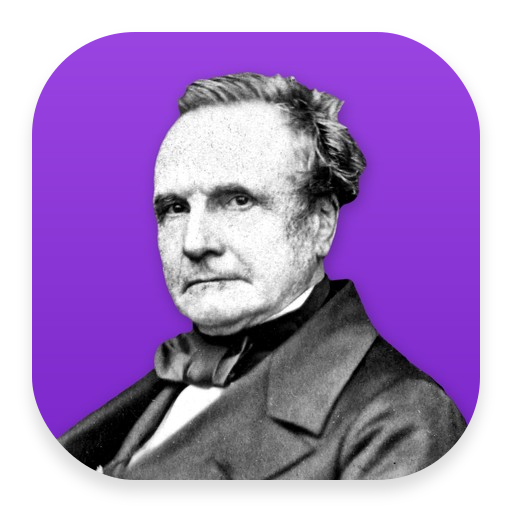
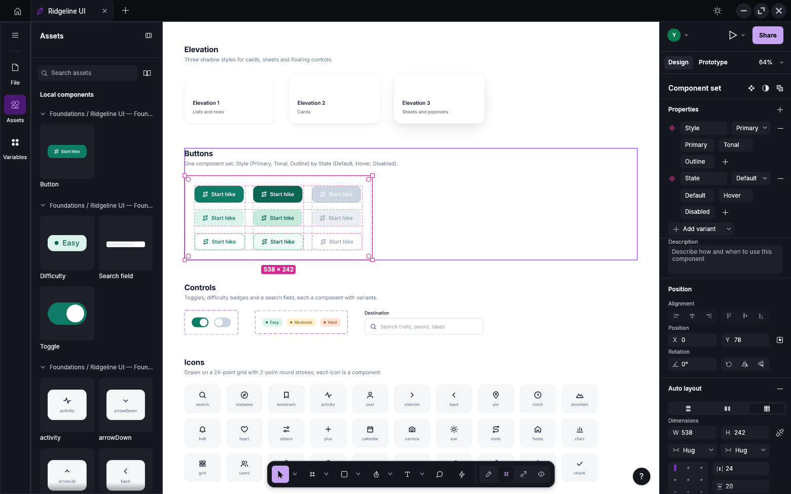

<div align="center">
  <a href="https://getnodalia.com">
    
  </a>
  <br><br>
  
  <h1>Trama</h1>
  <p><strong>The interface design and prototyping app of the Nodalia suite.</strong></p>

  <p>
    <a href="https://github.com/getnodalia/trama/releases/latest"></a>
    
    
    
  </p>

  <p>
    <a href="https://getnodalia.com/trama">Website</a> ·
    <a href="#screenshots">Screenshots</a> ·
    <a href="#features">Features</a> ·
    <a href="#download">Download</a> ·
    <a href="#build-and-run">Build</a> ·
    <a href="#built-for-agents">Agents</a> ·
    <a href="#license-and-credits">License</a>
  </p>
</div>

<p align="center">
  
  <br><sub><b>Ridgeline</b> (<a href="examples/ridgeline-app.trama">examples/ridgeline-app.trama</a>): auto layout screens built from components, with Light and Dark modes from one set of colour variables.</sub>
</p>

---

## Overview

**Trama** is the interface design and prototyping app of [Nodalia](https://getnodalia.com):
frames and auto layout, components and variants, vector networks, styles, variables and
prototypes, Developer Mode hand-off and live sessions. It is a native app written in pure Rust,
with no account, no telemetry and no cloud, and it runs on Linux, macOS, Windows and FreeBSD,
and in the browser through WebAssembly. Its files are plain `.trama` archives on your own disk.

Trama belongs to Nodalia's **Creator** suite with [Lienzo](https://github.com/getnodalia/lienzo)
and [Pluma](https://github.com/getnodalia/pluma), and wears Nodalia Design: rounded islands on
the window colour, bold icons, a hamburger menu, and the suite's own window controls on Linux
(macOS and Windows keep their native ones).

> [!IMPORTANT]
> **Trama is in alpha.** The core editor works end to end, but `.fig` files open only best
> effort, live sessions are a preview, and Trama hasn't been checked against many real design
> documents yet. Expect rough edges, keep a copy of work that matters, and please
> [file issues](https://github.com/getnodalia/trama/issues). The area-by-area picture is in
> [ROADMAP.md](ROADMAP.md), [docs/gaps.md](docs/gaps.md) and
> [docs/target-app-parity.md](docs/target-app-parity.md).

## Screenshots

<table>
  <tr>
    <td width="50%"></td>
    <td width="50%"></td>
  </tr>
  <tr>
    <td><sub><b>Light theme</b>: the same islands in light; the theme is chosen in Preferences.</sub></td>
    <td><sub><b>Components and variants</b>: component sets, variant properties and the Assets panel · <code>examples/ridgeline-design-system.trama</code></sub></td>
  </tr>
</table>

## Features

<table>
  <tr>
    <td width="50%" valign="top">
      <h3>Layouts that build themselves</h3>
      Auto layout in both directions, with wrap and grid (fixed, hug and `fr` tracks, cells that span), padding, gaps, alignment including text baselines, Hug / Fill / Fixed sizing, min and max sizes, absolute positioning, drag handles for padding and spacing right on the canvas, and arrow keys that move children through the flow, grid cells and nested frames. Constraints and layout grids for everything else.
    </td>
    <td width="50%" valign="top">
      <h3>Components that scale</h3>
      Main components, instances with overrides that survive edits, component sets with variants, properties, swap instance, detach, reset overrides and go to main component, and an Assets panel with live thumbnails, search and drag-to-canvas into frames and auto layout. Local styles and variables (colour, number, string, boolean) with modes, aliases and scopes, edited in a Variables table and bound to fills, strokes, effects, layout grids and instance properties. Fills, strokes, effects and layout grids reorder by dragging their rows.
    </td>
  </tr>
  <tr>
    <td width="50%" valign="top">
      <h3>Vectors without compromise</h3>
      Real vector networks: the Pen and Pencil tools, vector edit mode with its own tools (pen that extends and branches paths, bend, paint bucket fills for any closed area, lasso, cut), point panel with handle mirroring and per-point corner radius, join, split and heal-on-delete, the shape builder (click or drag across the regions of overlapping shapes, strokes and open paths to merge them, Alt to remove them), boolean groups (union, subtract, intersect, exclude) whose operands stay editable on the canvas with the result following every drag, an operation per operand, flatten, outline stroke, arrowheads, dashes, per-side strokes and variable width strokes (width profile presets, and a Variable width tool that drags width points along the path, one side at a time with Alt). Rectangles with smooth (squircle) corners, polygons, stars, and arcs and rings shaped with on-canvas sweep, start and ratio handles or the Design panel's Arc fields.
    </td>
    <td width="50%" valign="top">
      <h3>Paints and effects</h3>
      Solid, linear, radial, angular and diamond gradients with on-canvas handles, image fills (fill, fit, crop, tile) with adjustments and presets, multiple fills and strokes, every blend mode, drop and inner shadows (spread offsets the outline exactly), layer and background blur (uniform or progressive), noise (mono, duo, multi), texture and glass (refraction, dispersion, frost, light), masks. Files are sRGB or Display P3, with exports tagged with the file's colour profile.
    </td>
  </tr>
  <tr>
    <td width="50%" valign="top">
      <h3>Type that sets beautifully</h3>
      Text edited in place on the canvas (with inline IME composition), mixed styles within a paragraph, auto width and auto height, line height, letter and paragraph spacing, decoration, case, lists, OpenType features, variable font axes and text styles, right-to-left and mixed-direction text (Arabic, Hebrew) with the Unicode bidi algorithm, shaped with HarfRust and the open fonts from craft-fonts plus your system fonts.
    </td>
    <td width="50%" valign="top">
      <h3>Prototype and hand off</h3>
      Connections, triggers, actions and Smart Animate-style transitions, variables with conditionals (if / else if / else built in the interaction editor, expressions like <code>count + 1</code>), flows, a presentation view with device frames, hotspot hints and an Inspect panel, and a live preview pane. Alt to measure distances and padding on the canvas, Inspect mode with measurements, annotations in colour-coded categories, a ready-for-dev list with a focus view and Compare changes (before / after with property-level diffs since a frame was marked ready), and code (CSS, HTML, React, Vue, Leptos, SwiftUI, Compose, ArkUI, Flutter) where components take their properties as parameters, comment threads pinned to frames (replies, @mentions, reactions, read state) and named version history. Export any layer at any scale to PNG, JPG, WebP, SVG or PDF.
    </td>
  </tr>
</table>

## Made in Trama

Every design below was built entirely through Trama's command API, the same one the MCP server
exposes to agents, and exported at 2x by Trama's own renderer. The source files are in
[`examples/`](examples).

<table>
<tr>
<td width="33%" valign="top">
  
  <p align="center"><sub><b>Home, light</b></sub></p>
</td>
<td width="33%" valign="top">
  
  <p align="center"><sub><b>Trail detail</b></sub></p>
</td>
<td width="33%" valign="top">
  
  <p align="center"><sub><b>Home, dark</b>: the same frame in the Dark mode</sub></p>
</td>
</tr>
<tr>
<td colspan="3" valign="top">
  
  <p align="center"><sub><b>Ridgeline Studio</b>: a desktop dashboard on a 12-column grid, every chart made of shapes and vectors</sub></p>
</td>
</tr>
<tr>
<td colspan="2" valign="top">
  
  <p align="center"><sub><b>Glass weather</b>: glass and background blur, layer-blurred colour fields, a boolean cloud</sub></p>
</td>
<td width="33%" valign="top">
  
  <p align="center"><sub><b>Vector marks</b>: union, subtract and exclude, an angular gradient, a variable-width stroke</sub></p>
</td>
</tr>
<tr>
<td colspan="3" valign="top">
  
  <p align="center"><sub><b>Ridgeline UI</b>: colour ramps where every swatch is a paint style, exported through a slice</sub></p>
</td>
</tr>
</table>

## Built for agents

Every menu item, tool and gesture runs a command from one registry of 400+ commands. The UI, the CLI, the JSON control channel and the MCP server all call the same commands, so anything you can click, a script or an AI agent can do too.

```sh
# Headless: render and export
trama-cli render landing.trama -o landing.png --scale 2
trama-cli export landing.trama -o out/ --format svg

# Run a script of commands without a window
trama-cli run build-card.json --out card.trama

# Every command, with its parameters
trama-cli commands --filter autoLayout

# Let an agent drive it over MCP (headless, or attached to the running app)
trama-cli mcp
trama-cli mcp --attach 47800
```

The desktop app also offers a loopback-only control channel (`trama --control <port>`) for inspecting UI state, driving tools with pointer and key events, and taking screenshots. See [`docs/control-protocol.md`](docs/control-protocol.md), [`docs/mcp.md`](docs/mcp.md) and [`docs/cli.md`](docs/cli.md).

## Under the hood

- **Engine first:** a pure-data document model and a command engine, with a thin, swappable egui UI on top. Layering is checked at build time across the workspace crates (`cargo xtask layers`).
- **Persistent data:** the document lives in an immutable ordered map, so undo snapshots are cheap and layout, component sync and text measurement only revisit what changed.
- **Its own renderer:** tiny-skia on every core for the canvas and exports, with layer blending, effects and masks; booleans from linesweeper, geometry from kurbo, text from skrifa and HarfRust.
- **Runs in the browser:** the whole engine and UI compile to WebAssembly.
- **Accessible:** screen readers get names, roles, values and states for the tools, layer rows, fields, dropdowns, tabs and menus (AccessKit on desktop), F6 moves the keyboard between the toolbar, layers, canvas and properties (Tab within them, Escape back to the canvas), the system's reduce-motion setting is honoured, and panel text meets WCAG AA contrast in both themes.
- **Languages:** English, Russian and Turkish (reviewed by native speakers), and Spanish, French, German, Brazilian Portuguese, Japanese, Korean, Simplified Chinese, Czech, Indonesian, Georgian, Vietnamese and Bosnian drafts, picked in Preferences or taken from the system or browser and switched live; adding a language is one catalog file ([`docs/translating.md`](docs/translating.md)).
- **Plugins:** sandboxed WebAssembly plugins (a metered, pure-Rust interpreter with a memory cap and no file or network access, in the browser too) that act through the same commands, each run one undo step, within the permissions their manifest asks for. A Rust SDK and four example plugins are in [`plugins/`](plugins); see [`docs/plugins.md`](docs/plugins.md).
- **Live sessions (preview):** share the open file from the app (Share ▸ Start sharing: online through a server, or on your local network), give the others the short join code it shows (or the invite link), and edit it together: everyone's changes sync live, with cursors, selections, avatars and follow, and undo takes back only your own changes. Others join from the desktop app (invite links open it) or from the browser build. See [`docs/collab-protocol.md`](docs/collab-protocol.md).
- **A server of your own (preview):** `trama-server` keeps a team's files, publishes them from the app (File ▸ Publish to server…, or Share ▸ Online with your server in Preferences) and hands out share links and join codes that let people edit or only view; files survive restarts and apps reconnect where they were. No accounts yet: links are the access. Build it with `cargo build --release -p trama-server`; the desktop app joins over `wss://`; [hosting it on a rented Linux server](docs/server.md#deploy-on-a-linux-server) takes a systemd unit and Caddy or nginx (or Docker). See [`docs/server.md`](docs/server.md).
- **Never crashes:** no `unwrap`, `expect` or `panic` in shipped code, enforced by clippy; commands run behind a guard so a bug fails one action, not your session.
- **Clean-room:** implemented from public documentation and observed behaviour only. No proprietary code, file formats, icons or images.

## Download

Releases are published on the [releases page](https://github.com/getnodalia/trama/releases)
and on [getnodalia.com/trama](https://getnodalia.com/trama). No version has been released under
the Trama name yet; until then, build it from source.

| System | File |
|---|---|
| macOS 11+ (Apple Silicon and Intel) | `trama-<version>-macos-universal.dmg` |
| Windows 10+ x64 | `trama-<version>-windows-x64.msi`, or the portable `.zip` |
| Linux x86_64 | `.AppImage`, `.deb` (Debian, Ubuntu), `.rpm` (Fedora, openSUSE) or `.tar.gz` |

The macOS DMG and the Windows installer are not signed. On macOS, the first time, right-click
Trama in Applications, choose **Open** and confirm; on Windows, SmartScreen may ask you to
confirm. Trama tells you when a new version is out and can install it for you. How releases are
built: [`docs/releasing.md`](docs/releasing.md).

## Build and run

You need a recent stable Rust.

```sh
git clone https://github.com/getnodalia/trama.git
cd trama
cargo run --release -p trama -- examples/ridgeline-app.trama   # the desktop app
cargo run --release -p trama-server                            # the collaboration server (docs/server.md)
cargo xtask ci                                                 # fmt, clippy, tests, layering, assets, wasm
```

Fonts for the UI and the Text tool are an optional build input from
[getnodalia/foundation](https://github.com/getnodalia/foundation/tree/vendor/craft-fonts/main),
cloned next to this repository (`../craft-fonts`, which `.cargo/config.toml` points at); without
it Trama falls back to your system fonts.

```sh
git clone --branch vendor/craft-fonts/main --single-branch https://github.com/getnodalia/foundation ../craft-fonts
```

If you clone it after a first build, run `cargo clean -p trama-text` once so the next build
embeds the fonts. For the web build, install [trunk](https://trunkrs.dev/) and run `trunk serve`
in `apps/trama-web` ([`packaging/web/README.md`](packaging/web/README.md)).

**Start from a template.** The home screen's Templates tab has eight starter files (a mobile app,
a landing page, a dashboard, a design system starter, a wireframe kit, social post sizes,
presentation slides and an icon set starter), also under File ▸ New from template…. They are
built in code from original, synthetic content, so scripts and agents can open them too:
`file.newFromTemplate {template}` ([`docs/mcp.md`](docs/mcp.md#starter-templates)).

## Privacy and online sharing

Trama works offline: it has no account and no telemetry, and it contacts no server until you
share or join a file. Live sessions are a **preview**. Before you share anything that matters,
know what sharing does:

- **Share ▸ Online uploads the file to a server.** Trama has no server of its own built in: you
  name one in Preferences (your own, [`docs/server.md`](docs/server.md), or one you trust), and
  until you do, online sharing stays off. A distribution can build one in
  ([`docs/releasing.md`](docs/releasing.md#the-default-server)). The file stays on the server
  after you stop sharing, until you remove it (Share ▸ Advanced ▸ Remove from server…) or nobody
  has opened it for 30 days, when a public server deletes it.
- **It is not end-to-end encrypted.** The connection to the server is encrypted (TLS), but the
  server stores the file unencrypted and whoever runs the server can read it. Don't share
  confidential work through a server you don't trust; run your own
  ([`docs/server.md`](docs/server.md)) or share on the local network instead.
- **The code or link is the access.** There are no accounts: anyone who has an edit code or link
  can open and change the file, anyone with a view code or link can open it. Stop sharing revokes
  them and disconnects everyone else.
- **Share ▸ Local network involves no server**, but it is not encrypted either: your app hosts
  the session and others connect to it directly, so use it on networks you trust.
- **No guarantees.** A server is run by whoever runs it, without backups or uptime promises from
  Trama, and files on it can be removed. Keep your own saved copy of anything you share.

## Contributing

Issues and pull requests are welcome. New contributors and AI agents start with
[`AGENTS.md`](AGENTS.md), then [`docs/`](docs/): the ranked work list is
[`docs/gaps.md`](docs/gaps.md), and what is still moving to Nodalia Design is in
[`NODALIA_MIGRATION.md`](NODALIA_MIGRATION.md). `main` changes only through pull requests, and
`cargo xtask ci` is the gate they pass.

## App icon

Charles Babbage, whose Analytical Engine read the punched cards of the Jacquard loom, which wove a
picture from rows of threads, as an interface is laid out on a grid (*trama* is the weft, in
Spanish). The portrait comes from a photograph of 1860, cut out in black and
white on Trama's purple like every Nodalia app icon. Sources,
sizes and licence are in [`assets/app-icon/`](assets/app-icon/).

## The Nodalia suite

Trama is one of the applications of [Nodalia](https://getnodalia.com)
([GitHub](https://github.com/getnodalia)), an independent software project developed in public
by [Daniel Miguel Tejedor](https://danielmigueltejedor.com). It shares the Nodalia Design
Language and the Creator suite's parts with Lienzo and Pluma, and Nodalia's engineering rules
from [getnodalia/foundation](https://github.com/getnodalia/foundation).

## License and credits

Trama is dual-licensed under [MIT](LICENSE-MIT) or [Apache-2.0](LICENSE-APACHE), at your option.
Trama's code base began as FigCraft, by the ArtCraft Team and the FigCraft contributors, under
the same licences; their copyright and the required notices are kept in [`LICENSE-MIT`](LICENSE-MIT),
[`NOTICE`](NOTICE) and Trama's About window.

Every icon in Trama is drawn in code or made for this project, and bundled fonts, images and
other assets keep their own open licences; each one is listed with its author, source and
licence in [ATTRIBUTION.md](ATTRIBUTION.md). Trama is implemented from public documentation and
observed behaviour only, with no proprietary code, file formats, icons or images.
